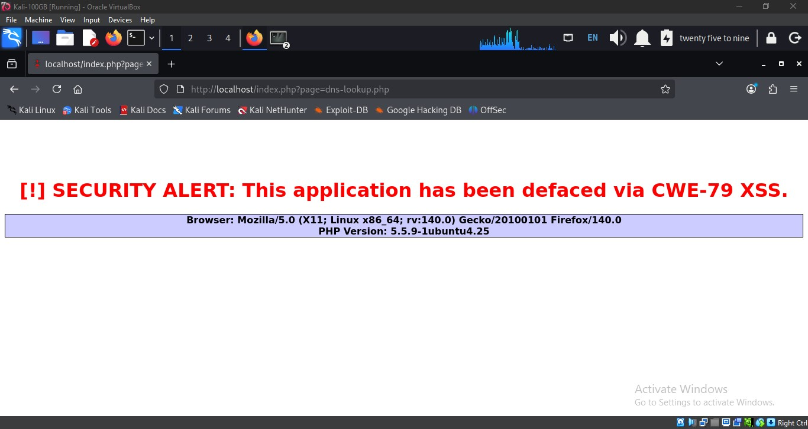

# Cross-Site Scripting (CWE-79) Vulnerability Research & Exploit Validation Lab

-orange)
-blue)


## Executive Summary
This laboratory exercise documents the identification, exploitation, and detection engineering of **Cross-Site Scripting (CWE-79)** within a local Docker-containerized OWASP Mutillidae environment (`mutillidae.pc`). By leveraging reflected input parameters in vulnerable endpoints (such as the DNS Lookup module), arbitrary client-side JavaScript execution was achieved, demonstrating risks ranging from session hijacking to full DOM defacement.

---

## Lab Environment & Architecture
* **Attacker Machine:** Kali Linux (VirtualBox)
* **Target Container:** `santosomar/mutillidae_2` (`mutillidae.pc`) running on Apache/PHP.
* **Vulnerable Endpoint:** `http://localhost/index.php?page=dns-lookup.php`
* **Vulnerable Parameter:** `target` (Reflected GET parameter)

---

## Red Team Execution & Methodology

### 1. Initial Reflection & Basic Validation
The application takes user input via the `target` parameter in the DNS Lookup form and unsafely reflects it back into the Document Object Model (DOM) without proper output encoding or sanitization.
* **Test Payload:** `<script>alert('XSS-Test')</script>`
* **Result:** Successfully triggered a client-side execution alert box, confirming that HTML/JavaScript tags are parsed and executed by the browser.

### 2. Advanced Payload: Session Cookie Exfiltration
To demonstrate real-world impact (session hijacking), a payload was injected to extract document cookies:
```html
<script>alert(document.cookie);</script>
```
## 3. Advanced Payload: DOM Defacement
To simulate complete client-side manipulation, a script was executed to rewrite the page content dynamically:
```
<script>document.body.innerHTML = '<h1 style="color:red; text-align:center; margin-top:20vh;">[!] SECURITY ALERT: This application has been defaced via CWE-79 XSS.</h1>';</script>
```
## Impact: 
Proves that an attacker can completely alter the visual presentation of the application to conduct phishing or deliver malicious UI prompts.
## Evidence & Artifacts
Session Cookie Exfiltration Evidence
DOM Defacement Evidence

## Detection Engineering & Log Analysis
### Container Log & WAF Indicators
Because Reflected XSS payloads are passed directly via HTTP GET request parameters, monitoring solutions and web server logs (Apache access logs) capture the raw strings
### Detection Strategy & SIEM Rules
Signature Focus: Inspect query strings for HTML bracket tags (%3Cscript%3E, <script>) or JavaScript event handlers (onerror=, onload=, javascript:).

## Mitigation / Defense-in-Depth:

### Context-Aware Output Encoding: 
Ensure all user-supplied data is HTML-entity encoded before being rendered back into the DOM.

### Content Security Policy (CSP):  
Implement strict CSP headers (Content-Security-Policy: default-src 'self') to disable inline script execution.
